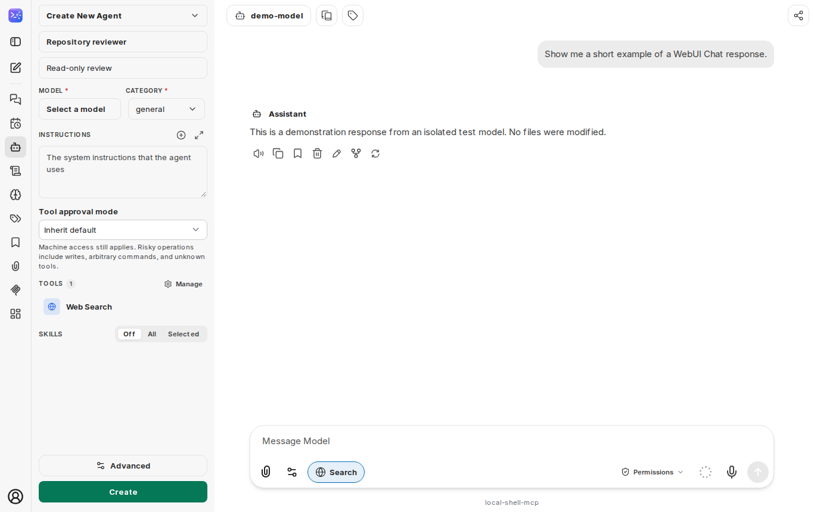

<!-- i18n-source-sha256: d33afa60bf803b367c950dbadf80fa77167568a970adcac204cdea7e9e965e45 -->
<!-- Machine-assisted translation; English source is authoritative. -->
# Agenti e competenze

## Quando creare un Agente

Un modello di chat diretto è utile per risolvere problemi o compiti che si presentano una sola volta. Un “Agente” rappresenta una configurazione salvata che può essere utilizzata più volte; può essere utilizzato anche in contesti di chat programmati, oppure può essere delegato ad altri agenti. Diversi agenti possono utilizzare canali, modelli, istruzioni e policy di accesso diversi. Tutti gli agenti condividono lo stesso “Controller”, ma non necessariamente lo stesso ambito di memoria o gli stessi strumenti.

## Configurare un Agente

Gestisci l’Agent tramite l’interfaccia WebUI: crea un nuovo Agente, assegna a esso un nome riconoscibile e scegli il modello che meglio si adatta alle sue funzionalità. Scrivi le istruzioni necessarie per descrivere il compito da svolgere, l’output desiderato, i vincoli e i requisiti di verifica. Configura le capacità necessarie all’Agente, poi salva e inizia una nuova conversazione con esso.



Ad esempio, un revisore di un repository potrebbe avere queste istruzioni:

```text
Verificare i cambiamenti rispetto alla versione principale attuale.
Esaminare il repository e i risultati dei test prima di trarre conclusioni.
Non modificare i file, non effettuare commit o distribuire alcun contenuto.
Segnalare eventuali problemi, indicando le relative posizioni e le prove disponibili.
```

Le istruzioni sono utili per guidare il comportamento delle macchine, ma non rappresentano una limitazione per l’accesso alle informazioni. È consigliabile impostare l’accesso alla macchina su “solo lettura”. Inoltre, è meglio ignorare le funzionalità esterne inutili, nel caso in cui il revisore non voglia modificare alcunché. Per ulteriori informazioni, consultare la sezione [Strumenti e permessi](permissions.md).

È preferibile utilizzare agenti separati per svolgere compiti diversi, come ad esempio il controllo del codice, l’implementazione delle soluzioni proposte e le operazioni di gestione. Dare a ciascun agente un accesso limitato alle informazioni necessarie per svolgere il proprio ruolo. Se un agente non riesce a funzionare correttamente, è necessario verificare il canale di comunicazione utilizzato e il modello utilizzato da tale agente, prima di modificare impostazioni non correlate al suo ruolo.

## Skills

I pacchetti di strumenti per l’apprendimento contengono istruzioni riutilizzabili e file correlati. Di norma, questi pacchetti vengono forniti insieme a… `SKILL.md` Gestione delle competenze nel WebUI: è possibile abilitare le competenze pertinenti e renderle disponibili per l’Agent o per i chatter. Il modello può scoprire e caricare il contenuto relativo alle competenze in base alle esigenze. Una competenza può descrivere un flusso di lavoro, fornire esempi o contenere script; tuttavia, tale competenza non esegue automaticamente dei script, né concede ulteriori permessi al sistema.

È necessario verificare le competenze importate prima di abilitarle. Gestare le istruzioni e i file associati a queste competenze come se si trattasse di codice o istruzioni fornite da terzi. I nomi e le descrizioni delle competenze devono essere sufficientemente specifici affinché il modello possa riconoscerle facilmente. È importante separare le referenze importanti, mentre si preferiscono soluzioni più semplici e utilizzabili autonomamente. Il registro presente sul lato del controller e i metodi utilizzati per chiamare gli strumenti sono descritti in [Skills](../guides/skills.md).

Il contesto relativo alle abilità automatiche e alla memoria viene memorizzato in modo automatico, in modo da evitare la necessità di ripetere il messaggio del sistema ad ogni turno. I cambiamenti nelle abilità possono essere applicati immediatamente; è quindi consigliabile utilizzare una nuova conversazione per testare i nuovi contesti automatici creati. Un’abilità impostata appositamente è diversa dal “snapshot” iniziale relativo alle abilità automatiche.

## Delegazione e subagenti

Gli agenti possono delegare i compiti limitati ai sub-agenti, quando tale possibilità è disponibile. Un sub-agente può utilizzare un agente configurato, ma mantenere la propria thread di esecuzione. Il supervisore coordina il lavoro, legge i risultati ottenuti dal sub-agente e può continuare l’esecuzione della thread salvata. È possibile ispezionare le attività svolte dal sub-agente dal punto di vista del supervisore; tale visualizzazione non è un chat indipendente e modificabile.

È consigliabile utilizzare la delegazione per compiti separabili, come revisioni indipendenti, aree di file distinte o l’indagine su diverse ipotesi. È necessario fornire al subagente un obiettivo preciso, un ambito di lavoro e un risultato atteso. Si evita la scrittura concorrente sui stessi file, a meno che il lavoro non venga coordinato chiaramente.

La delega deve rimanere entro i limiti di autorizzazione previsti dal genitore. Non è possibile concedere accesso a macchine o servizi che il genitore stesso non può utilizzare; le politiche di approvazione del bambino non possono indebolire quelle del genitore. Le operazioni svolte dal bambino possono consumare token e tempo in modo indipendente; pertanto, è necessario controllare le loro attività e i risultati ottenuti, al fine di valutare i costi e il progresso delle operazioni stesse.

## Strumenti, azioni e risultati

The Agent Builder mette a disposizione la sua libreria di strumenti e le opzioni di configurazione avanzata. È necessario selezionare soltanto quelle funzionalità di cui si ha bisogno. Per ogni azione HTTP descritta tramite uno schema OpenAPI, è importante verificare l’endpoint, i requisiti di autenticazione e le operazioni consentite prima di connettersi all’azione in questione. Le azioni possono avere le proprie procedure di autenticazione; una permesso fornito da una macchina non autorizza né revoca i dati di autenticazione forniti da terzi. È importante verificare la risposta dell’azione prima di considerare che la mutazione avvenuta remotamente sia completa.

Per il contenuto UI generato, è necessario configurare il rendering degli artefatti come descritto in “[Conversazioni e progetti”](conversations.md). Il codice generato non rappresenta una valida estensione del controller.

## Modelli pratici per agenti

- **Investigatore di tipo “solo lettura”:** Ispezionare i log e le fonti dei dati; confrontare le prove disponibili; determinare le cause dei problemi. Nessuna modifica è permessa.
- **Agente di implementazione:** È necessario modificare il repository, eseguire i test mirati, riportare eventuali differenze e i problemi non risolti. Inoltre, è richiesta l’approvazione per le operazioni sensibili, se questo è necessario.
- **Monitoring Agent**: Verifica le macchine specificate e comunica lo stato, eventuali errori e i progressi ottenuti. Non riavvia i processi, a meno che non venga autorizzato esplicitamente.
- **Agente di ricerca:** permette la ricerca su rete, cita i documenti originali, distingue le prove dalle inferenze, e utilizza strumenti meccanici soltanto quando necessario.

I template rappresentano delle istruzioni, non dei preset predefiniti. È necessario configurare le autorizzazioni e le capacità di ciascun agente in modo che siano corrispondenti alle mansioni da svolgere.
