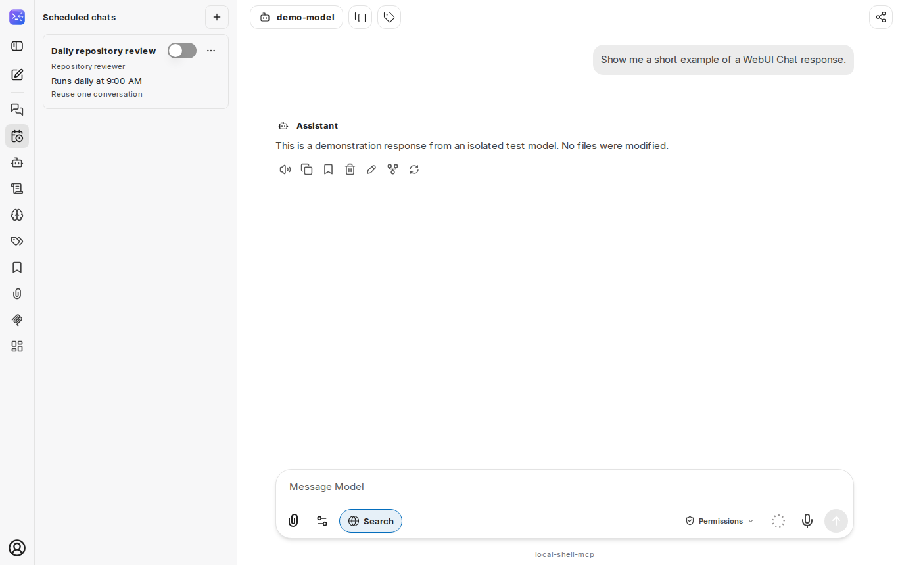

<!-- i18n-source-sha256: 01c14c19cf5addf99299993b57542259bcb40bbfb13600758b516a86c89e716b -->
<!-- Machine-assisted translation; English source is authoritative. -->
# Cele, planowane rozmowy oraz długotrwałe prace

## Wybierz odpowiedni mechanizm

| Mechanizm | Cel |
|---|---|
| Standard generowanie rozmów | Odpowiadanie na aktualne polecenia, w tym wywoływanie narzędzi |
| Rozmowa z określonym celem | Kontynuowanie aktywnego planu działania po przekroczeniu granic modelu |
| Planowane rozmowy | Uruchom agenta z zachowanym poleceniem w określonej kolejności. |
| Działanie na stałe lub w trybie ciągłym | Wykonywanie poleceń bez względu na indywidualne żądania modelu |
| Podagent | Przekazać zadanie ograniczone do innego wątku agenta |

Planowane rozmowy nie stanowią ciągłych zadań w systemie operacyjnym. Logiczna sesja nie jest żadną rozmową ani procesem oprogramowania operacyjnego. Zakończenie takiej sesji nie oznacza koniecznie zakończenia wszystkich czynności rozpoczętych przez jej elementy.

## Rozmowa z określonym celem

W przypadku długotrwałych zadań należy poprosić Agenta o określenie konkretnego celu oraz utrzymanie planu wykonania zadania za pomocą narzędzi logicznych do zarządzania sesjami. Plan ten zawiera informacje o poszczególnych etapach wykonania zadania oraz ich statusie. Czas trwania działania może być kontynuowany bez względu na to, czy użytkownik wprowadza nowe polecenia, czy też zewnętrzny timer wykonywania zadań nie wystarcza.

Sprawdź plan i postęp pracy. Możesz wstrzymać realizację zadania, ponownie je rozpocząć lub anulować go za pomocą dostępnych kontroli. Kontynuowanie pracy wymaga aktywnego planu i prawidłowo przygotowanego zadania; nie należy kontynuować pracy nad już ukończonym, blokowanym lub anulowanym zadaniem. Powtarzające się identyczne reakcje bez żadnego postępu powodują wstrzymanie realizacji zadania, a nie jej ciągłe powtarzanie się (obecnie po trzech niezmienionych punktach na trasie). Zwalcz proszonych przeszkód przed ponownym rozpoczęciem pracy.

Należy określić kryteria zakończenia pracy. Na przykład: sprawdzenie repozytorium, wdrożenie poprawki, przeprowadzenie odpowiednich testów oraz zgłoszenie wszystkich błędów. Należy kazać Agentowi zapisywać dokładne identyfikatory commitów oraz wyniki testów, a nie uznawać sukcesu tylko na podstawie własnego planu.

Mechanizm celowy zewnętrznego klienta MCP jest oddzielony od pozostałych elementów systemu. Szczegółowe informacje dotyczące procesu przenoszenia danych z logicznej sesji na Live Workspace można znaleźć w dokumentacji [Human interface](../guides/human-interface.md).

## Utwórz planowany rozmowę.



Otwórz obsługę planowanych rozmów. Utwórz harmonogram z opisanym nazwą, zapisanym agentem, poleceniami, czasem i częstotliwością realizacji rozmów. Wybierz cel rozmowy; w razie potrzeby wybierz projekt, który będzie objęty nową rozmową. Zapisz i aktywuj ten harmonogram. Użyj opcjonalnie funkcji kontroli pracy ręcznej, aby sprawdzić konfigurację przed jej realizacją.

Wspierane tempo wykonywania obowiązków obejmuje godzinne, dzienne, tygodniowe, miesięczne, cron z pięcioma punktami oraz ciągłe wykonywanie zadań. Ciągłe wykonywanie zaczyna się po upływie ustawionego opóźnienia; brak opóźnienia może spowodować ciągłe obciążenie serwera i maszyny. Zwykłe, regularne harmonogramy wymagają minimalnego okresu czasu wykonywania zadań – pięciu minut. Należy używać specjalnego regionu czasowego według standardów IANA. `Asia/Shanghai` lub `UTC`Należy sprawdzić wyświetlany tekst po zachowaniu pliku.

Przykład cron na 09:00 w dni robocze:

```text
0 9 * * 1-5
```

W tym przypadku używany jest wybrany czasowy okres, a nie koniecznie czasowy okres systemu operatora. Należy sprawdzić, czy w wybranym czasowym okresie obowiązuje taki system, jeśli tak jest.

## Cele konwersacji:

- **Nowa rozmowa przy każdym uruchomieniu:**: należy uruchomić osobną konwersację dla każdego wykonywanego zadania; to przydatne w przypadku tworzenia niezależnych raportów.
- **Używaj ponownie jednej rozmowy:**: można użyć już istniejącej konwersacji dla kolejnych wykonywanych zadań; to przydatne w celu kontroli całkowitego przebiegu zadania.
- **Użyj istniejącej rozmowy:**: można wybrać już istniejącą konwersację, która będzie wykorzystywana do realizacji kolejnych zadań.

Wykorzystany lub istniejący dialog może się rozwijać i wymagać uporządkowania. Należy wybierać niezależne rozmowy, gdy kontekst historyczny nie jest potrzebny. Planowane operacje zależą od tego, czy wybrany agent oraz kanał modelu nadal istnieją i są dostępne do użycia.

## Uprawnienia bez kontroli:

Wykonanie harmonogramu należy do Controllera i używa zapisanych nazw autoryzowanych zakresów zamiast przechowywania tokenu logowania przeglądarki. W razie potrzeby zapisz lub uruchom harmonogram ręcznie, aby go autoryzować. Obowiązują uprawnienia maszynowe wskazanego Agenta; zwykłe nadpisania maszyn projektu lub rozmowy nie stanowią polityki maszyn harmonogramu. Nadal obowiązują ograniczenia Controllera, zapisana autoryzacja, możliwości narzędzi i zatwierdzanie narzędzi.

W przypadku zewnętrznych serwerów MCP wymagających uwierzytelniania interaktywne logowanie nie oznacza automatycznie odnawialnej zgody na wykonanie bez nadzoru. Jeśli interfejs harmonogramu zgłasza konieczność ponownego uwierzytelnienia lub dostępu bez nadzoru, skonfiguruj dane uwierzytelniające danego serwera albo usuń zależność przed włączeniem harmonogramu. Nie używaj ponownie tokenów przeglądarki jako zamiennika.

Należy używać tylko części, które umożliwiają monitorowanie. Należy wyraźnie określić zalecane cele, pożądanych wyników oraz działania, których należy unikać. Jeśli zadanie planowe wymaga interwencji lub zgody człowieka, należy sprawdzić sytuację w tym zakresie. Nie należy zakładać, że bezczynne wykonywanie zadania oznacza nieograniczoną dostępność do danych. Przykład komunikatu monitoringu:

```text
Sprawdź określone zadanie szkoleniowe i jego logi.
Zgłoś aktualny etap, straty, przepływ danych, czas realizacji i wszelkie nowe błędy.
Nie moduj plików, nie restartuj zadania ani nie uruchamuj nowych zadań.
Jeśli dane są niedostępne, zgłoś dokładną przyczynę.
```

## Cykl życia i odzyskiwanie danych

Controller przechowuje planowane operacje, stan uruchomienia oraz informacje o wydarzeniach w sposób transakcyjny, aby uniknąć duplikacji operacji. Okienka przeglądarki nie muszą być otwarte po zakończeniu działania. Nie należy zakładać, że przegapione wydarzenia są zawsze ponownie realizowane, ani że wszystkie dane związane z operacjami przetrwają restart Controller. Należy sprawdzić ostatnie wykonane operacje, kolejne operacje, bieżące wykonywanie zadań oraz informacje związane z komunikacją po przerwach w działaniu systemu.

Nieaktualizuj harmonogramów, aby zapobiec ich dalszym realizacjom automatycznym. Sprawdź każdy już realizowany zlecenie osobno; zatrzymanie dalszych realizacji nie gwarantuje anulowania obecnego zadania lub pracy w trybie „shell”. Usuń harmonogramy, które nie są już potrzebne, oraz odejmij niepotrzebne uprawnienia agenta.

Zadanie lub terminal stworzone przez agenta WebUI może przetrwać po zakończeniu normalnego procesu realizacji zadania. Sam restart kontrolera nie musi skutkować zakończenia tego zadania. Wyraźne przerwanie procedury, utrata uprawnień do obsługi maszyny lub wygaśnięcie uprawnień mogą spowodować anulowanie prac realizowanych przez agenta. Jeśli pracownik znajduje się w stanie offline, anulowanie pracy może pozostać w toku, dopóki zadanie nie zostanie dostarczone. Należy sprawdzić sam zadanie lub terminal przed oświadczeniem o zakończeniu jego realizacji. Agent może wysyłać lub przerywać prace realizowane przez siebie tylko poprzez specjalny interfejs WebUI. Zewnętrzne klienty MCP zachowują swoją naturalną semantykę.

Narzędzia związane z tłumaczeniem obrazów oraz zadania podagenta mają swoje własne cykle życia. Wynik może być jeszcze w trakcie dostarczenia, nawet po zakończeniu wykonywania zadania. Sprawdź panel zadania tła i pobierz wynik, albo pozwól na ponowne uruchomienie zadania przez administratora. Nie uruchamiaj duplikatu zadania tylko dlatego, że wynik jest jeszcze niedostępny.

Dla poleceń, które powinny przetrwać poza okresem funkcjonowania danego narzędzia, należy używać zadań śledzonych przez LSM lub terminali zachowujących się w trybie ciągłym. Wyniki pracy należy zapisywać do pliku logów, rejestrować identyfikatory zadań oraz sprawdzać ich postęp. Zobacz [Wzory użycia](../guides/usage-patterns.md).
