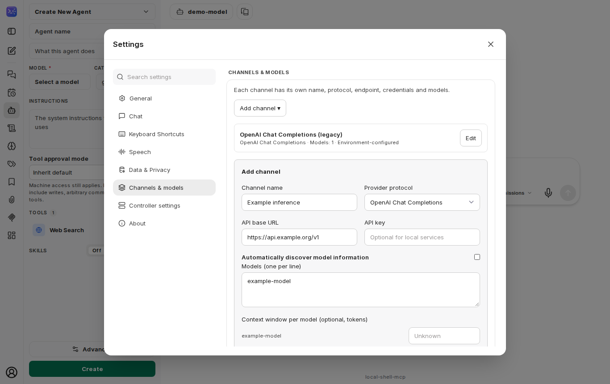

<!-- i18n-source-sha256: 158a01475edc97cea1a70bc0d7b9a7330f7240dce14e7269635e675d044eedae -->
<!-- Machine-assisted translation; English source is authoritative. -->
# القنوات والنماذج

## قم بإعداد قناة جديدة.

افتح قائمة اختيار النماذج في Chat، ثم ادخل إلى قسم إدارة القنوات. اختر النموذج الذي تريده. **أضف القناة إلى القائمة**اختر نوع الاتصال، أدخل المعلومات المطلوبة، ثم احفظ التغييرات. اختر نموذجًا من ذلك القناة لإجراء محادثة جديدة. بالنسبة للعميل المخصص، يمكنك اختيار القناة والنموذج في إعدادات العميل.

القنوات تخضع لإدارة Controller، وليست إعدادات المحادثة الشخصية. في الحالات التي يتم فيها التحقق من الهوية، يتطلب إدارة القنوات استخدام صلاحيات `admin:config`. يمكن للمشرفين تعديل القنوات المشتركة دون الحاجة إلى توزيع مفاتيح API على مستخدمي المحادثة.

القنوات العادية لها اسم، بروتوكول المزود، عنوان URL الأساسي، معلومات الاعتماد، وأرقام الهوية الخاصة بالنماذج. استخدم مفتاح API صادرًا للنقطة النهائية المختارة، وليس كلمة المرور الخاصة بحساب LSM. يقوم LSM بإرسال الطلبات من Controller؛ لذا قد لا يعمل العنوان URL الذي يُستخدم على الكمبيوتر الشخصي في Controller.

| البروتوكول | عنوان URL الأساسي لـ API | الاستخدام |
|---|---|---|
| OpenAI Chat Completions | `https://api.openai.com/v1` | بوابات المحادثة المتوافقة مع OpenAI، وخوادم الاستنتاج المحلية |
| OpenAI Responses | `https://api.openai.com/v1` | بوابة تسمح بالوصول إلى API للردود |
| مواطن أنثروبي | `https://api.anthropic.com/v1` | واجهات برمجية متوافقة مع الرسائل البشرية |
| جوجل الجوزاء الأصلي | `https://generativelanguage.googleapis.com/v1beta` | تقوم وحدة Gemini بإنشاء واجهات برمجية متوافقة مع تقنيات GenerateContent. |

استخدم الرابط الأساسي المطلوب من قبل المزود، بدلاً من نسخ رابط الطلب الكامل، مثل الرابط الذي ينتهي بـ… `/chat/completions`المنصة التي تدعي أنها متوافقة مع OpenAI قد تدعم إمكانية إرسال رسائل نصية، لكنها لا تدعم إرجاع ردود أو استخدام الأدوات المختلفة، ولا تدعم إدخال بيانات متعددة الأشكال أو خيارات التفكير. يجب اختيار البروتوكول الذي تدعمه المنصة فعليًا. URLs المذكورة هي مثال على البروتوكولات المستخدمة، وليست وعدًا بإمكانية الوصول المجاني أو توافر الخدمات.

## النقاط النهائية المحلية والعرفية

بالنسبة للخادم المتوافق مع OpenAI، والذي يتصل مباشرة بالجهاز الرئيسي، فإن العنوان الأساسي قد يكون `http://127.0.0.1:8080/v1`. أما عند تشغيل الخادم داخل Docker، فإن “loopback” يشير إلى ذلك الحاوية، وليس إلى الجهاز الفعلي. يجب استخدام عنوان يمكن الوصول إليه من خلال شبكة الجهاز الرئيسي. تسجيل العامل البعيد وحده لا يكفي لجعل واجهة الإسقاط متاحة.

يتطلب نموذج التحقق من صحة الروابط HTTPS، باستثناء الروابط من نوع HTTP في الأجهزة التي تستخدم نظام الاتصال الخاص بها.`localhost`, `127.0.0.1`, `::1`يجب أن يكون هناك نقطة نهاية HTTP على عنوان الشبكة المحلية، أو اسم خدمة Docker، ويجب أن يتم توفير هذه النقطة النهاية عبر بوابة HTTPS. لا يمكن استخدام نقطة النهاية الخاصة بالدردشة الموجودة في الخادم الأصلي. يجب ألا تحتوي عناوين URL الأساسية على بيانات اعتماد أو جزء من السلسلة أو سلاسل الاستعلام.

استخدم بروتوكول TLS للاتصال بالنقاط البعيدة، وحدد الوصول إلى الواجهات الخاصة الموثوقة فقط. كما يجب التحقق من هوية النماذج المستخدمة مع خادم الاستنتاج. لا تضع كلمات المرور الخاصة بالواجهات البرمجية في أي مكان، سواء في الرسائل أو الصور الشاشية أو سلاسل الاستعلام أو الإعدادات المنشورة. اترك كلمة المرور خالية عند تعديل قناة معينة، حتى يتم الحفاظ على كلمة المرور المحفوظة. استخدم الاتصال بدون كلمة مرور فقط عندما يدعم الخدمة ذلك.

## الإعدادات الافتراضية المخصصة للبيئة:

يمكن تهيئة إعدادات OpenAI المدمجة قبل البدء في العمل، باستخدام `LOCAL_SHELL_MCP_MODEL_BASE_URL` (أو `OPENAI_BASE_URL`)، و`LOCAL_SHELL_MCP_MODEL`، و`LOCAL_SHELL_MCP_MODEL_API_KEY` (أو `OPENAI_API_KEY`). يمكن لإعدادات Anthropic وGoogle المدمجة قراءة `ANTHROPIC_API_KEY` و`GOOGLE_KEY` / `GOOGLE_API_KEY` على التوالي. الإعدادات المخزنة تكون ذات أولوية على الإعدادات الافتراضية الخاصة بالبيئة؛ استخدم القنوات المسماة للاتصال بعدة نقاط بعيدة. الإعدادات الافتراضية المخصصة للبيئة ليست بديلًا لحماية أسرار الخدمة.

## تفويض حساب ChatGPT:

قناة الحساب/الكود تستخدم عملية تأكيد صلاحية حساب ChatGPT، وليس مفتاح API العادي. يمكن بدء عملية التأكيد من خلال إدارة القناة، ثم تسجيل الدخول إلى صفحة التأكيد الرسمية. في الحالات المحلية، يمكن أن يتم إكمال عملية التأكيد تلقائيًا. إذا لم يتمكن المتصفح من الوصول إلى جهاز الاستماع، فيمكن نسخ رابط العملية بأكمله من شريط العناوين، ثم وضعه في مربع الحوار الخاص بالتأكيد. من المتوقع حدوث عطل في الاتصال عند عنوان الاستماع هذا.

تعامل مع عنوان URL للاستدعاء العكسي باعتباره بيانات اعتماد: لا ترسله أبداً في محادثة ولا تنشره علناً. يخزن Controller التفويض على الخادم ويجدد بيانات الاعتماد عندما يكون ذلك ممكناً. أعد تفويض الحساب إذا انتهت صلاحيته أو أُلغي الوصول إليه. تحدد خدمة الحساب الأصلية النماذج المتاحة وحدود الخطة والاستخدام المسموح به؛ ولا يوفر LSM حصة اشتراك إضافية.

## اكتشاف النماذج وحدود السياق

يجب تفعيل خاصية الاكتشاف التلقائي، حتى يمكن طلب معلومات النماذج من المزود. يقوم الجهاز باسترجاع هذه المعلومات بشكل دوري، حاليًا كل عشر دقائق؛ كما يمكن أيضًا إعادة تحديث البيانات يدويًا. في حالة فشل عملية الاكتشاف، يتم الاحتفاظ بالبيانات المحفوظة سابقًا. إذا كان المزود لا يمتلك نقطة اتصال متوافقة لإرسال قائمة النماذج، فيجب إيقاف خاصية الاكتشاف وإدخال معرفات النماذج يدويًا، واحد في كل سطر.

يجب تحديد قيمة نافذة السياق لكل نموذج عند معرفتها. القيمة المحددة لكل نموذج تغيير البيانات المعلوماتية المحفوظة أو تعويض القيم الناقصة. يقبل المحرر من 1 إلى 2,000,000 رمزًا؛ هذه قيمة تكوينية، وليست ضمانًا بأن المزود سيدعم هذا الحجم من البيانات. يجب استخدام الحد الأقصى المناسب لعملك، مع الأخذ في الاعتبار التكوينات الخاصة بالخادم والحدود الخاصة بالنماذج نفسها.

## أخذ العينات والحسابات والاستخدام

يتم التحكم في معلمات الطلبات التي يدعمها المزود المختار من خلال إعدادات القنوات والنماذج. يمكن لمحرر الدردشة أن يعرض معلومات الحسابات عند وجودها. البروتوكولات المختلفة تنفذ عملية أخذ العينات والحسابات بطرق مختلفة؛ قد لا يدعم بعض البروتوكولات نموذجًا معينًا. يجب البدء بإعدادات المزود الأصلية، ثم تغيير إعداد واحد في كل مرة.

يمكن لـ LSM أن تطلب معلومات دقيقة حول استخدام رموز التدفق، ويمكنها الاعتماد على خيارات الاستخدام الأخرى في حالة رفض المزود لهذه الخيارات. العقدة التي لا تُعيد بيانات الاستخدام لا يمكنها تقديم بيانات فصلية أو إحصائيات ذاكرة التخزين المؤقت. راجع [الذاكرة والسياق](context.md) لمعرفة الفرق بين الاستهلاك التراكمي والقدرة الحالية على التخزين.

## تغيير وإلغاء القنوات

الحوار يحتفظ بنموذج الوكيل والتاريخ المتعلق به. يجب تغيير النموذج بشكل متعمد عند تغيير نقاط النهاية أو عند تصحيح مشاكل الخدمة. يُسمح بإعادة تسمية القناة المستخدمة فقط لحماية الإشارات المرجعية. حذف قناة مستخدمة يتطلب تأكيدًا إضافيًا؛ التاريخ لا يزال موجودًا، لكن الوكيلات والدردشات التي تشير إلى القناة المُحذوفة يجب أن تختار بديلًا مناسبًا قبل الاستمرار في العملية.

إعدادات القنوات تكون على جانب الخادم، وليست مسبقة فقط للتصفح. البيانات الخاصة بالوصول لا تُعاد عبر ردود قائمة القنوات العادية. يجب حماية دليل حالة الـ Controller والنسخ الاحتياطية كبيانات تحتوي على بيانات الوصول.

## قائمة التحقق من الاتصال

1. تأكد من أن الـ Controller يمكنه الوصول إلى مضيف الـ API، وأن بروتوكول TLS صحيح.
2. تأكد من المسار الأساسي، البروتوكول، البيانات الخاصة بالوصول ورقم النموذج الدقيق.
3. أعد تشغيل القناة أو اختر نموذجًا معروفًا يدويًا.
4. أرسل رسالة بسيطة بالنص العادي، ثم اختبر استخدام الأداة الصغيرة.
5. تحقق من تفاصيل الخطأ، سواء كان ذلك بسبب حالة HTTP، أو فترة انتظار طويلة، أو خيارات غير مدعومة؛ لا تكرر محاولات الوصول إلى بيانات الوصول غير الصحيحة.

راجع [الإدارة والحلول للمشاكل](administration.md) لمعرفة كيفية التعامل مع الحدود السرعة، وتوقف التدفق، وأخطاء التأهيل.
