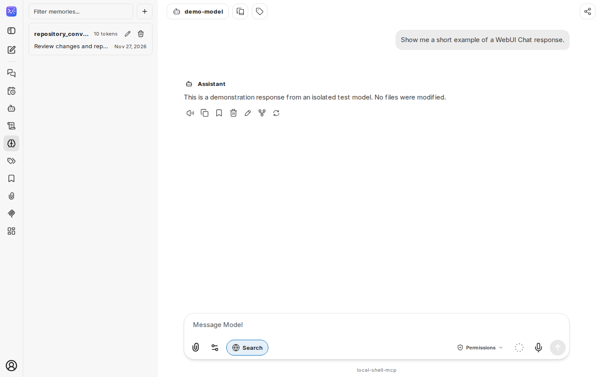

<!-- i18n-source-sha256: 214687d6067b7dc2dd2b6eec1a207aa50be3ab9550d081f8a60e3013684c0250 -->
<!-- Machine-assisted translation; English source is authoritative. -->
# Bellek, bağlam ve anahtar kullanımı

## Üç farklı türde devlet vardır.

| Devlet | Amaç/Hedef |
|---|---|
| Sohbet geçmişi | Controller tarafından kaydedilen orijinal mesajlar ve araçların aktiviteleri. |
| Bağlam penceresi | Belirli bir model isteğiyle gönderilen talimatların, araç şemalarının, geçmiş bilgilerin, özetlerin ve diğer verilerin alt kümesi. |
| Kalıcı hafıza | Yeniden kullanılabilir bilgiler ve tercihler, ilgili hafıza alanındaki konuşmalarda kullanılabilir. |

Uzun süreli kaydedilmiş bir konuşma, tüm geçmişi kaybetmeden modelin bağlam penceresini aşabilir. “Hafıza” demek, tüm hesap geçmişinin her model talebine gönderileceği anlamına gelmez.

## Bellek yönetimi

Hafıza, varsayılan olarak etkin durumdadır; ancak kullanıcının ayarlarından veya sohbet özelliklerinden veya dağıtım/Agent yeteneklerinden dolayı devre dışı bırakılabilir. Saklanan verileri incelemek ve düzenlemek için “Hafıza Yönetimi” sayfasını kullanın. Agent’dan faydalı bilgileri, proje kurallarını veya tercihlerini hatırlamasını isteyin ve sonuçları “Hafıza Arayüzü”nde kontrol edin.

Bir belge girişini düzenlerken, sadece küçük harfler ve alt çizgiler içeren bir anahtar kullanılmalıdır (örneğin, `repository_conventions`). Varsayılan karakter uzunluğu sınırı 10.000 karakterdir; bir kurulum, bellek depolama sınırlarını kendi istediği şekilde ayarlayabilir. Eğer bir giriş reddedilirse, hataları incelemek daha iyidir; çünkü gizlilik bilgilerini farklı anahtarlar arasında bölmek mantıklı değildir.

Hafıza, Agent yapısına bağlı olarak, paylaşılan bir kişisel havuzu veya Agent-özgü bir kapsamı kullanabilir. API anahtarlarını, şifreleri veya gereksiz hassas verileri hafızada saklamayın. Hafızayı devre dışı bırakmak, bu verilerin ilgili kapsamda kullanılmasını engeller; bu, mevcut verilerin silinmesi veya konuşma geçmişinden çıkarılmasıyla aynı şey değildir.

Eğer maruz kalınırsa, model `set_memory` fonksiyonunu kullanarak bir girdi oluşturur veya günceller; boş bir değer ise bu girdi silinir. `find_memory` fonksiyonu, sorgu veya tam anahtarlarla girdiyi bulur; boş bir sorgu ise kaydedilen bilgileri listeler. İsteğe bağlı olan `include_conversations` işareti, diğer konuşmalardaki metinleri de aramasını sağlar. Sayfa sayma işleminde `page` (varsayılan değer 1) ve `limit` (varsayılan değer 10, maksimum 50) kullanılır. Bu tarihsel bilgilerin geri çağrılması işlemi, ham araç çağrı kayıtları yerine konuşma metinlerini içerir. Bilgi geri çağrımı, ilgili olan bilgilere göre yapılır; bu nedenle gerekirse doğru isimler veya terimler kullanarak sorguyu daha ayrıntılı hale getirmek gerekir.

Otomatik belge/Yetenek enjeksiyonu, konuşmanın devamındaki her adımda sabit kalır. Böylece tekrar kullanılabilir sağlayıcı komutların başlıkları korunmuş olur. Saklanan bilgileri düzenlemek, zaten enjekte edilmiş verileri geriye dönük olarak yeniden yazmaz. Açıkça belgeyi çağırma işlemi, şu anki saklanan verilere erişir; eğer yeni bir konuşma gerekiyorsa, yeni bir konuşma başlatılır.

## Bağlamsal kapasite

Her bir modelin gerçek bağlam sınırlarını kendi kanallarında belirleyin. Controller, modelin görünebilecek olan girdileri tahmin eder ve çıktılar için yer ayırır. Mevcut bütçe uygulaması, etkili model ve çalışma zamanı yapılandırmalarına bağlı olarak %85 sıkıştırma oranı ve %5 rezerv oranı ile gerçekleştirilir. Sayıların yaklaşık olması durumunda, bu durum yabancı bir tokenleyici, çok modlu bir istek veya sağlayıcıya özgü bir şemayla ilgili olabilir.

Bağlamsal kompozisyon, sistem talimatları, Ajan yapılandırmaları, araç tanımları, ekler, önceki mesajlar ve araç sonuçlarını içerebilir. Bir sağlayıcı, farklı bir ayrıştırıcı kullanabilir veya ek iç veriler de sayabilir. Bu bilgileri sadece işlem rehberi olarak kabul edin; bunları sağlayıcının garantisini oluşturmak için kullanmayın.

## Otomatik sıkıştırma

Eğer bir bağlam bütçesi sıkıştırılması gereken bir durumdaysa, Controller daha eski verilerin özetini oluşturur veya günceller ve sonraki model istekleri için gerekli bilgileri saklar. Bu özet, hedefler, kısıtlamalar, kararlar, ilerleme durumu, ilgili tanımlayıcılar, araçların sonuçları ve bir sonraki adımlar gibi bilgileri korur. Orijinal olarak kaydedilen bilgiler ise hâlâ incelenebilir durumdadır. Özet ise model tarafından oluşturulan bir yaklaşımdır; mükemmel bir birebir taklit değildir.

Bir sonraki isteklere başlamadan önce sıkıştırma işlemi yapılır. Eğer sıkıştırma işlemi başarısız olursa, motor hata yönetimi mekanizmasına göre yeniden deneme yapar ve artık aşırı büyüklükteki girdileri kullanarak işleme devam etmemelidir. Sıkıştırma durumunu ve eğer işlem devam edemiyorsa ilgili hataları kontrol edin. Son mesajlar ve araç çağrıları/sonuçlarının ilişkileri tutarlı olmalıdır. Tamamlanmış eski araç sonuçları, sadece bağlamı küçültmek için sürekli olarak yeniden yazılmamalıdır.

Tek bir büyük dosya veya araç sonucu bile bütçe aşabilir. Sınırlı çıktılar, dosya aralıkları veya özetler talep edilmelidir; büyük sonuçlar dosyalara kaydedilmeli ve belirli kısımlar tekrar tekrar model bağlamına eklenmemelidir.

## Kumulatif kullanım ve önbellek tıklamaları

Sessiyon kullanımı ve bağlam penceresinin yanıtları farklı soruları cevaplar. Giriş/çıkış kullanımı, konuşma sırasında model istekleri arasında birikir; tekrarlanan bağlamlar da bu sürece dahildir. Önbellek metrikleri, sağlayıcının bildirdiği önbellek bilgilerini gösterir. Bağlam kapasitesi, aktif modelin kullanımını ölçer ve geçmişteki her bir istek için toplanmaz.

Örneğin, 20.000 girdi jetonu içeren bir istek, ardından 25.000 girdi jetonu içeren başka bir istek geldiğinde, toplamda 45.000 girdi jetonu kullanılır. Ancak ikinci istekte yaklaşık 25.000 girdi jetonu kullanılmaktadır. Önbelleklenmiş jetonlar, sağlayıcının fiyatlandırma politikası böyle olmadığı sürece ücretsiz değildir. Daha büyük bir model bağlam sınırı, daha fazla kapasite gerektirir; ancak daha önce kullanılan miktar değişmez.

Sıkıştırma işlemi, mevcut kullanım oranını düşürebilir; ancak aynı zamanda model tüketimini artırır. Model değiştirme işlemi, uygulanabilir sınırları değiştirir; ancak daha önceki tüketimi silmez. Eğer bir sağlayıcı, kesin kullanım miktarlarını veya önbellek metadatalarını göz ardı ederse, tahminler ve metrikler eksik olabilir. Finansal hesaplamalar için sadece LSM görünümlerini değil, aynı zamanda sağlayıcının faturalandırma verilerini ve fiyatlandırmasını da kullanın.

## Maliyetleri azaltın ve faydalı bilgileri koruyun.

Belirlenen talimatları uygulayın; gereksiz büyük çıktılardan kaçının ve sadece gerekli bilgileri kullanın. İlgisiz konularla ilgili işler için ayrı bir konuşma başlatın. Devir alma işlemi gerektiğinde, doğru yolları, imzaları, gözlemlenen sonuçları ve halen çözülmemiş sorunları içeren kısa bir kaydı saklayın. Önemli bilgileri, sadece üretilen özetlere dayanmak yerine orijinal kaynaklara veya araç sonuçlarına göre doğrulayın.
