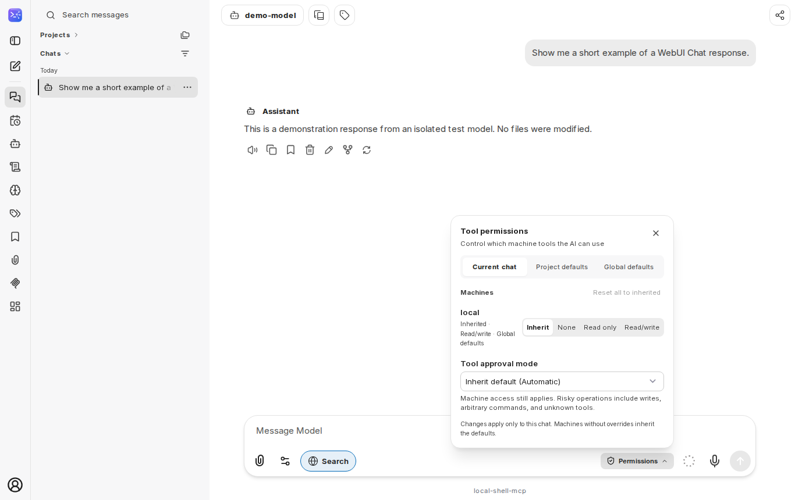

<!-- i18n-source-sha256: e5ebd5f8cfb42332f4e38d63eabe47a6274ceacf919130202203bd85917f3469 -->
# 工具、機器與權限

## 授權層級

工具出現在列表中並不保證可以執行。實際授權結合 Controller 限制、已認證身份的 Scope、機器策略、智慧體能力和工具審批。提示詞無法單獨強制執行權限。

對於已序號產生器器（包括啟用的 Controller 本地執行目標），聊天機器策略預設讀寫。敏感部署應收緊預設值。未知機器名不會獲得隱式授權。Controller 可以分別禁用本地執行和遠端 Worker。

## 機器權限

| 權限 | 含義 |
|---|---|
| 無 | 不可執行機器操作 |
| 只讀 | 僅允許歸類為只讀的操作；任意 Shell/Python 執行不屬於只讀 |
| 讀/寫 | 在其他限制範圍內允許授權的讀取、修改及執行操作 |
| 繼承 | 使用適用的上級預設值，而非顯式覆蓋 |

在機器權限控制元件中設定全域性預設值、專案覆蓋和會話覆蓋。具體會話覆蓋優先於專案覆蓋，後者優先於全域性預設。智慧體可以透過逐機器設定或預設策略進一步限制權限；顯式智慧體權限不會繞過身份 Scope 或 Controller 限制。

例如，全域性讀寫、專案只讀、智慧體讀寫時，該專案會話權限為只讀，除非會話顯式覆蓋專案設定。即使會話設為讀寫，也無法超過智慧體的只讀上限。

使用指定智慧體執行定時任務時，採用智慧體機器策略及儲存的授權 Scope，而非普通聊天機器覆蓋。參見[Goal 與自動化](automation.md)。無人值守任務應使用單獨的受限智慧體。

## 工具審批

| 模式 | 行為 |
|---|---|
| 自動執行 | 授權工具呼叫無需額外審批，除非其他顯式策略要求 |
| 危險操作審批 | Controller 對歸類為危險的操作要求稽核，包括任意 Shell 命令和多種外部呼叫 |
| 全部審批 | 普通工具呼叫需要審批 |

聊天審批設定可以繼承智慧體和全域性預設。已有顯式拒絕或審批規則仍然有效。子智慧體不能弱化父智慧體審批模式。審批與權限獨立，批准一個被拒絕的機器操作不會授予機器訪問權限。

批准前檢視實際引數、目標和潛在副作用。無人值守工作流應審慎設定智慧體及審批策略；必須人工確認的操作可能阻塞進度。不要僅為減少提示而擴大權限。

## 原生與外部 MCP 工具

原生工具透過 LSM 在 Controller 及已註冊 Worker 上操作，包括檔案、Shell 與 Job、瀏覽器與 GUI、遠端發現、邏輯會話等。精確引數見[工具參考](../reference/tools.md)，機器加入方式見[遠端 Worker](../guides/remote-workers.md)。

在 WebUI 管理巢狀 MCP 伺服器。支援本地 stdio 和遠端 HTTP 傳輸，可設定各伺服器的環境變數或請求頭。在聊天和相關智慧體中啟用外部 MCP 能力。智慧體可以發現、檢查和呼叫可用外部工具，仍然受到相關授權和審批約束。

外部 MCP 工具可能獨立於原生機器權限，例如禁用本地機器訪問後，外部遠端 API 仍可能修改資源。因此應分別審查外部服務權限和憑證。不要在持有敏感檔案的 Controller 上安裝不可信的 stdio 服務。

## Ask User 與功能開關

Ask User 允許智慧體請求結構化人工輸入，避免自行猜測。透過介面展示的問題控制元件回答。這是資訊請求，不能用於繞過拒絕的工具權限。無人值守時，應明確如何處理不確定性，並在認定任務完成前檢查待處理互動。

輸入區提供網路搜尋、外部 MCP、記憶等功能控制。這些開關決定模型可使用的能力，與授權獨立；關閉功能不會刪除歷史結果。網路搜尋預設開啟，使用[網路搜尋](../guides/webui-network-search.md)所述只讀 Web 工具。

## 審計和驗證

在聊天中檢查工具呼叫及結果，排障時展開摺疊的詳情。Controller 審計日誌記錄原生工具活動，Job/Session 可用於檢視持續執行。API 返回成功只代表工具返回結果，不保證外部操作達到目標。應獨立驗證寫入、遠端任務狀態和部署健康情況。參見[審計日誌](../guides/audit-log.md)。
