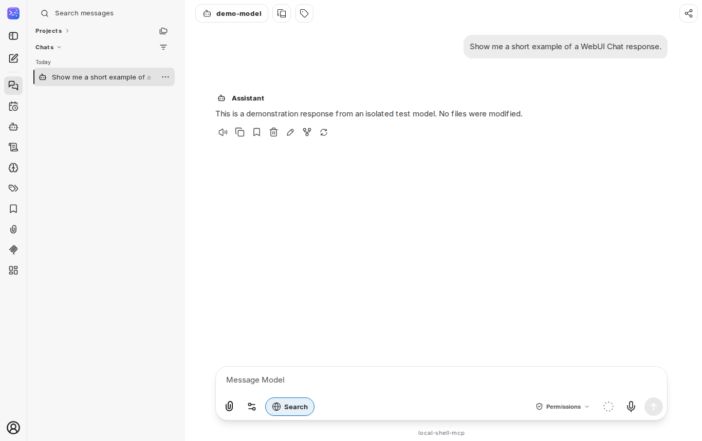

<!-- i18n-source-sha256: 01cf883cb71925e93fabc21d32315ef8c869ee2ea548e54a0347e2f6b730a327 -->
<!-- Machine-assisted translation; English source is authoritative. -->
# WebUIチャットのクイックスタート

統一されたLSMウェブワークスペースでは、AIチャット、プロジェクト、エージェント、そしてコントローラーの操作画面が一体化されています。このシステムはPythonコントローラーによって実行され、その認証機能やSQLiteデータベースを利用しています。別途チャットサーバーは必要ありません。[ChatGPT](chatgpt-connector.md)や[Gemini](gemini-spark.md)といった外部のMCPクライアントも引き続きサポートされています。

## 1. Controller を起動する

お好みのランタイム環境に合わせて、[インストールクイックスタートガイド](quickstart.md)に従ってください。WebUIが有効になっていることを確認し、永続的なストレージを使用してください。以下は、一般的なデフォルト設定です。

```env
LOCAL_SHELL_MCP_STATE_BACKEND=sqlite
LOCAL_SHELL_MCP_UI_ENABLED=true
```

サービス環境をエクスポートした後、Controllerを起動してください。

```sh
local-shell-mcp --mode mcp
```

シングルファイルでのリリースには、ダウンロードした実行ファイルを使用してください。インストールされたControllerは、コンパイルされたフロントエンドを提供します。JavaScriptのビルドツールチェーンは、ソースコードのビルドにのみ必要です。[WebUIのビルド手順](https://github.com/fwerkor/local-shell-mcp/blob/main/ui/workspace/README.md)を参照してください。

## 2. ブラウザーのワークスペースを開く

開く `http://127.0.0.1:8765/ui` コントローラーホストから、または設定されたHTTPS URLからアクセスします。 `/ui`そのデプロイメントで設定されているLSM認証を使用してログインしてください。リモートアクセスには、認証されたHTTPSを使用してください。チャットページとコントロールページは同じオリジンを持っています。

## 3. モデルチャネルを追加する

モデル選択画面やチャンネル管理を開きます。APIチャンネルを追加するか、サポートされているアカウントを接続してください。OpenAIと互換性のあるエンドポイントの場合は、チャンネルの名前を入力し、「Chat Completions」を選択します。その後、APIの基本URLと認証情報を入力し、モデルを検索するか、既知のモデルIDを指定してください。設定内容を保存したら、適切なモデルを選択します。

ローカルな推論サービスを使用する場合は、Controllerからアクセス可能なアドレスを使用する必要があります。単にブラウザからアクセスできるアドレスでは不十分です。例えば、`http://127.0.0.1:8080/v1`というアドレスが適切です。このアドレスは、Controllerのネットワーク名前空間内で推論サービスが動作している場合に使用できます。[チャンネルとモデルについては、](../chat/channels.md)を参照してください。ここでは、プロトコル、アカウント認証、モデルの検出、コンテキストの制限などについて説明されています。

## 4. 最初のタスクを実行する

チャットを開始し、簡単な質問をして、モデルの接続性を確認してみましょう。その後、読み取り専用のツールを使ってみてください。

```text
Controllerワークスペースのルートにあるファイルを一覧表示してください。
どの機械を検査したか教えてください。そして、その結果を簡単にまとめてみてください。
ファイルを変更したり、何らかの書き込みを行ったりしないでください。
```

実際のツールの結果を確認してください。ツールが表示されない場合は、チャット内のツールのオプションや、Agentの設定、マシンの権限などを確認してください。繰り返し実行されるタスクには、保存されたAgentを使用し、そのアクセス権を明確に設定してください。詳細は[ツールと権限](../chat/permissions.md)を参照してください。



このガイドおよび以降のページに掲載されているスクリーンショットは、デモ用のコントローラー上で撮影されたものです。これらのスクリーンショットには、実際の運用時の認証情報や会話内容は含まれていません。英語で表示されるUIのラベルは、選択されている言語とは異なる場合があります。

## 5. ワークスペースを確認する

| エリア | それを何に使うかです。 |
|---|---|
| チャットとプロジェクト | チャットを開始したり、検索したりする。また、プロジェクトやタグ、メッセージのブックマークを整理することもできる。 |
| Agents | 再利用可能なモデル、指示、ツールの設定。 |
| 記憶とスキル | 再利用可能な知識や指示を管理する。 |
| 定期的に実行されるチャット | 保存されたエージェントを、定期的に実行させるように設定します。 |
| ファイルとターミナル | ControllerおよびWorker環境を検査したり、操作したりすることができます。 |
| デスクトップ | サポートされているリモートGUIセッションを監視したり、操作したりする。 |
| セッション、仕事、監査 | 耐久性のあるタスク、実行状況、およびツールの活動状況を確認してください。 |
| 機械や外部のMCP | 作業員や、ネストされたMCPサーバーを管理する |

使用可能なコントロールの詳細は、デプロイメントやアカウントの状態、および有効になっている機能によって異なります。ブラウザを閉じるだけでは、サーバー側での処理が中止されるわけではありません。作業を中断する必要がある場合は、「停止」コントロールを使用してください。

## 次のステップ

完全なワークフローについては、[WebUIチャットガイド](../chat/index.md)をご覧ください。また、本番環境の設定やバックアップ、エラー時の対処法については、[管理とトラブルシューティング](../chat/administration.md)をご覧ください。
